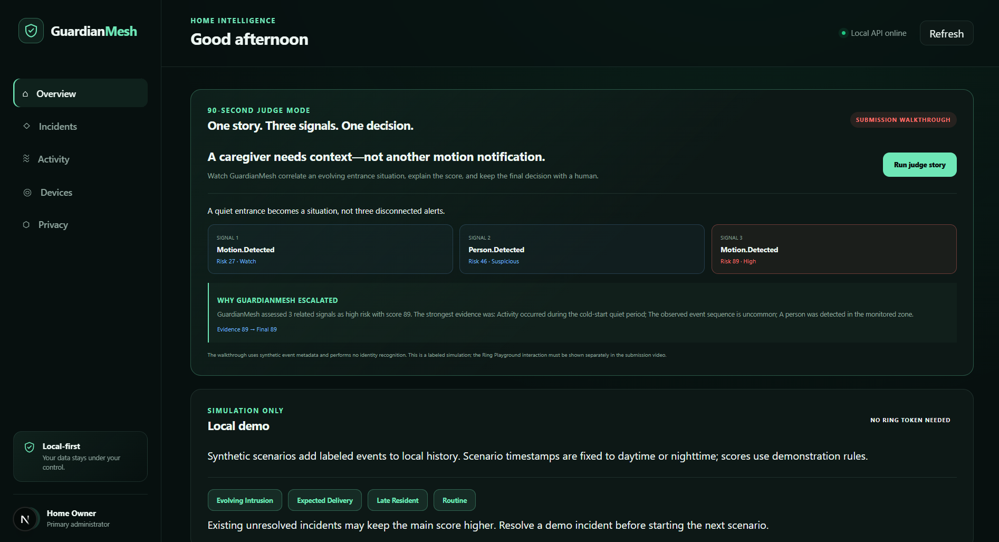
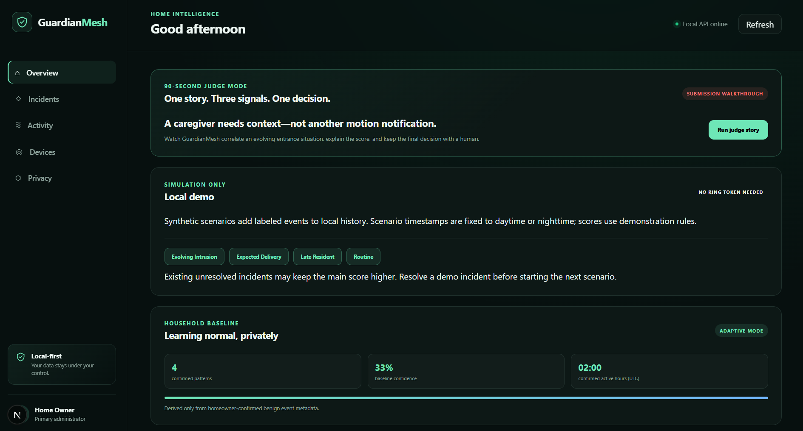
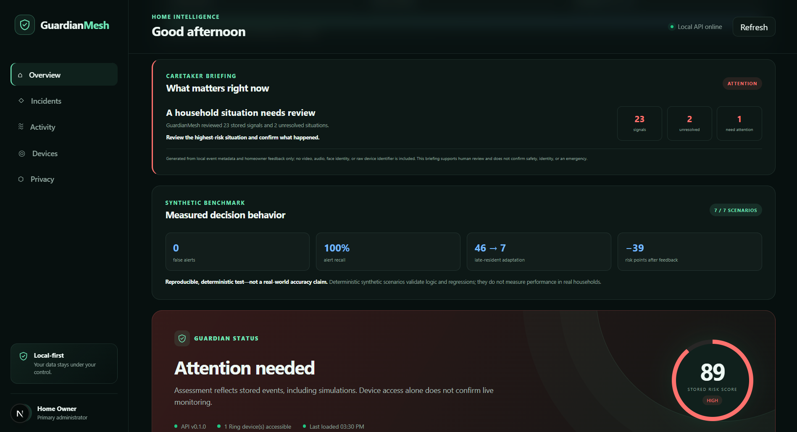
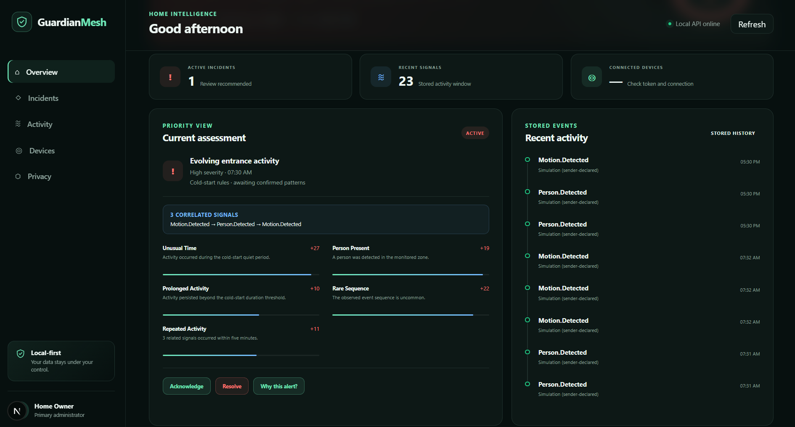
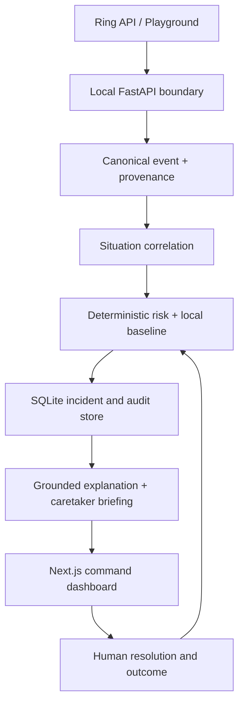

# GuardianMesh

### Ring detects events. GuardianMesh understands situations.

GuardianMesh is a privacy-first household intelligence layer for Ring. It correlates isolated device signals into situations, learns routines only from homeowner-confirmed outcomes, explains every risk contribution, and keeps consequential decisions with people.

[](https://www.python.org/)
[](https://fastapi.tiangolo.com/)
[](https://nextjs.org/)
[](#verified-evidence)
[](LICENSE)

> Built by [Naren M](https://github.com/Naren-M-5) for the Ring track of the Build, Ship, Shape: Amazon Developer Hackathon 2026.



## Why this exists

A motion notification says something happened. It does not tell a homeowner or caregiver whether three nearby signals form one expected arrival, a familiar routine, or a situation that deserves attention.

GuardianMesh converts that notification stream into an auditable answer:

- **What happened together?** Signals from the same area are correlated within five minutes.
- **How unusual is it here?** A local baseline learns only from confirmed benign outcomes.
- **Why did the score change?** Every contribution and contextual adjustment is visible.
- **What would lower the score?** Counterfactuals show the result without each major factor.
- **Who makes the final call?** The homeowner resolves the situation and labels the outcome.

GuardianMesh does not identify people, predict crime, diagnose health conditions, or autonomously contact emergency services.

## The memorable demo

Judge Mode tells one deterministic story in under 90 seconds:

| Beat | Correlated signal | Risk | Interpretation |
|---|---|---:|---|
| 1 | Motion at a quiet time | 27 | Watch |
| 2 | Person detected at the same entrance | 46 | Suspicious |
| 3 | Repeated, prolonged activity | 89 | High |

Instead of producing three disconnected alerts, GuardianMesh creates one evolving incident, reconstructs the final score, shows counterfactuals, and asks a human to confirm the outcome.

The repository also integrates the official Ring device and event-history APIs. Local scenarios are clearly labeled synthetic and are not presented as substitutes for the required Ring Playground demonstration.

## Product evidence

### Private adaptation—not surveillance

GuardianMesh learns from homeowner-confirmed benign outcomes and stores only the event metadata needed to recognize a household pattern.



### A briefing a caregiver can act on

The command center compresses stored signals into a clear next action while keeping benchmark limitations visible beside the result.



### Every point is inspectable

The risk engine exposes correlated signals and each deterministic contribution instead of hiding the decision behind an opaque model.



## Architecture



### Trust boundaries

- Ring OAuth credentials remain in the backend-only local `.env` file.
- Raw Ring device identifiers are stripped before dashboard responses.
- Stored intelligence uses event metadata rather than video, audio, faces, or identity labels.
- Risk is deterministic; an LLM cannot silently alter a score.
- All incident transitions create audit records.
- Simulation, Ring history, and legacy sources remain visibly distinguishable.

See the [threat model](docs/architecture/threat-model.md), [privacy design](docs/privacy/privacy.md), and [architecture decisions](docs/decisions/).

## Product capabilities

| Capability | What is implemented |
|---|---|
| Ring integration | Device discovery and deduplicated event-history synchronization |
| Situation intelligence | Temporal correlation and ordered multi-signal sequences |
| Adaptive baseline | Homeowner-confirmed benign patterns influence later matching activity |
| Explainability | Evidence arithmetic, context adjustments, and counterfactual scores |
| Human feedback | Acknowledge, resolve, structured outcomes, notes, and audit history |
| Caretaker briefing | Metadata-only summary with explicit safety limitations |
| Judge Mode | Canonical three-beat walkthrough separated from official Ring proof |
| Evaluation | Reproducible labeled scenarios with documented limitations |
| Recording safety | Preflight catches expired tokens, stopped services, and regressions |

## Verified evidence

A clean clone was installed and built on Windows with Python 3.12 and Node.js 24:

- **42 automated tests passed**
- **7/7 deterministic labeled benchmark scenarios passed**
- **0 npm audit vulnerabilities**
- **Next.js production build and TypeScript checks passed**
- **Build completed with a clean Git worktree**
- **Ring Playground device discovery and event sync were exercised at runtime**

The synthetic benchmark currently reports zero false alerts and full alert recall across its seven labeled cases. That is a regression result, **not a real-world accuracy claim**. The consent-based next-stage protocol is documented in [docs/validation-plan.md](docs/validation-plan.md).

## Quick start

### Requirements

- Python 3.11+
- Node.js 20+
- A Ring Playground token only for live Ring API testing

### 1. Backend

```powershell
git clone https://github.com/Naren-M-5/GuardianMesh.git
cd GuardianMesh

py -3.12 -m venv .venv
.\.venv\Scripts\python.exe -m pip install --upgrade pip
.\.venv\Scripts\python.exe -m pip install -e ".[dev]"
Copy-Item .env.example .env

.\.venv\Scripts\python.exe -m uvicorn apps.api.app.main:app --reload --env-file .env --host 127.0.0.1 --port 8000
```

API documentation: <http://127.0.0.1:8000/docs>

### 2. Dashboard

In a second terminal:

```powershell
cd GuardianMesh\apps\dashboard
Copy-Item .env.local.example .env.local
npm ci
npm run dev
```

Dashboard: <http://localhost:3000>

### macOS / Linux notes

Use `python3 -m venv .venv`, `source .venv/bin/activate`, and `cp` instead of the PowerShell-specific commands above.

## Ring Playground connection

1. Create a private Ring application and select only the scopes required for the demonstration.
2. Generate a temporary token in Ring Playground.
3. Store it locally in `.env`:

```env
GUARDIANMESH_RING_ACCESS_TOKEN=your-temporary-token
```

4. Restart FastAPI, open the dashboard, and choose **Sync Ring events**.
5. Never paste credentials into issues, screenshots, commits, recordings, or submission text.

Playground tokens are temporary. Run the recording preflight immediately before rehearsing or recording:

```powershell
.\.venv\Scripts\python.exe scripts\demo_preflight.py --recording
```

Proceed only after it reports `READY FOR RECORDING`.

## Test and evaluate

```powershell
.\.venv\Scripts\python.exe -m pytest -q
.\.venv\Scripts\python.exe scripts\evaluate_scenarios.py
```

Expected benchmark scores:

| Scenario | Expected attention | Score |
|---|---:|---:|
| Routine | No | 0 |
| Delivery | No | 19 |
| Expected delivery sequence | No | 18 |
| Learned late resident | No | 7 |
| Homeowner live view | No | 0 |
| Intrusion | Yes | 78 |
| Evolving intrusion | Yes | 89 |

The late-resident feedback case moves from **46 → 7** after three owner confirmations, while intrusion remains above the alert threshold.

Read the full [evaluation methodology and limitations](docs/evaluation.md).

## API highlights

| Method | Endpoint | Purpose |
|---|---|---|
| `GET` | `/api/v1/health` | API health and version |
| `GET` | `/api/v1/integrations/ring/devices` | Discover authorized Ring devices |
| `POST` | `/api/v1/integrations/ring/sync` | Import and deduplicate Ring history |
| `GET` | `/api/v1/incidents` | List stored situations |
| `GET` | `/api/v1/incidents/{id}/explanation` | Reconstruct evidence and counterfactuals |
| `POST` | `/api/v1/incidents/{id}/resolve` | Record outcome and feedback |
| `GET` | `/api/v1/briefing` | Produce privacy-safe caretaker context |
| `GET` | `/api/v1/evaluation` | Return synthetic benchmark report |
| `POST` | `/api/v1/demo/judge-story` | Run the local canonical walkthrough |

Full contract notes: [docs/api/openapi-notes.md](docs/api/openapi-notes.md).

## Repository map

```text
apps/api/                      FastAPI boundary and Ring client
apps/dashboard/                Next.js local command center
packages/guardianmesh_core/    correlation, risk, baseline, explanation, storage
packages/event-schema/         canonical event contract
packages/risk-schema/          explainable risk contract
scripts/                       replay, evaluation, and recording preflight
simulations/                   deterministic scenario fixtures
tests/                         backend and dashboard contract tests
docs/                          architecture, privacy, validation, ADRs, API notes
```

## Safety and current limitations

- Ring Playground tokens expire and must be refreshed for live demonstrations.
- The benchmark is synthetic and deterministic; real-household validation has not yet been performed.
- GuardianMesh supports human review and does not confirm that a home is safe or that an emergency exists.
- The current implementation is a local-first prototype, not a certified security or emergency-response product.
- Multi-household validation must use explicit consent and report sample size, missing data, labeling procedures, and uncertainty.

These limitations are intentionally visible in the product and documentation.

## Documentation

- [Judge Mode walkthrough](docs/judge-mode.md)
- [Demo recording preflight](docs/demo-preflight.md)
- [Synthetic evaluation](docs/evaluation.md)
- [Field-validation plan](docs/validation-plan.md)
- [Adaptive household baseline](docs/architecture/adaptive-baseline.md)
- [Situation correlation](docs/architecture/situation-correlation.md)
- [Grounded explanations](docs/architecture/grounded-explanations.md)
- [Threat model](docs/architecture/threat-model.md)
- [Local-first privacy](docs/decisions/ADR-003-local-first-privacy.md)

## Author

**Naren M** — [GitHub](https://github.com/Naren-M-5) · [LinkedIn](https://www.linkedin.com/in/naren007/)

## License

Licensed under the [Apache License 2.0](LICENSE).
