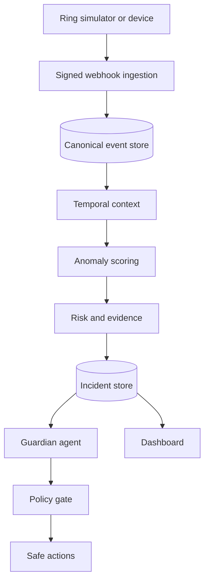

# System architecture

## Runtime flow

## Boundaries

1. Ingestion verifies authenticity, validates, deduplicates, normalizes, persists, and acknowledges quickly.
2. Temporal and anomaly components determine what is unusual; they do not declare danger.
3. Risk produces a deterministic score and evidence contributions.
4. The agent explains structured evidence and can request actions; it cannot alter risk or bypass policy.
5. Policy defaults unknown actions to deny and requires confirmation for consequential deterrence.

The V1 runtime is a modular monolith. Logical service directories document later deployment boundaries without forcing a solo developer to operate unnecessary microservices.

## Local and AWS mapping

| Concern | Local | AWS demo target |
|---|---|---|
| HTTP ingress | FastAPI | API Gateway + Lambda |
| Event delivery | In-process pipeline | EventBridge |
| Domain store | SQLite | DynamoDB |
| Evidence media | Ephemeral/local fixtures | S3 with lifecycle policy |
| Agent | Deterministic stub/tools | Strands + Bedrock/AgentCore |
| UI updates | Poll/SSE | SSE or managed event delivery |
